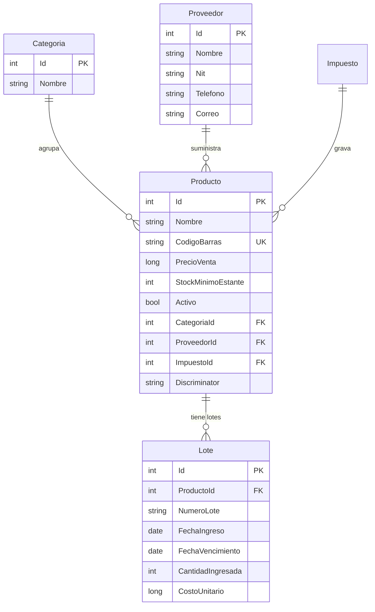
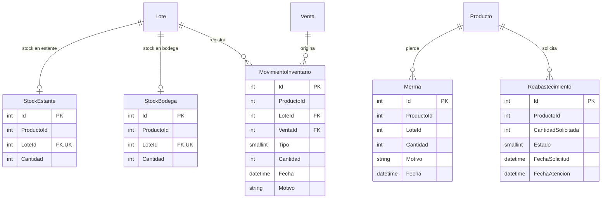
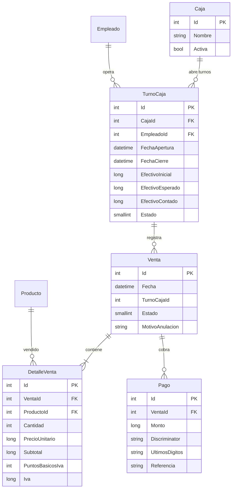
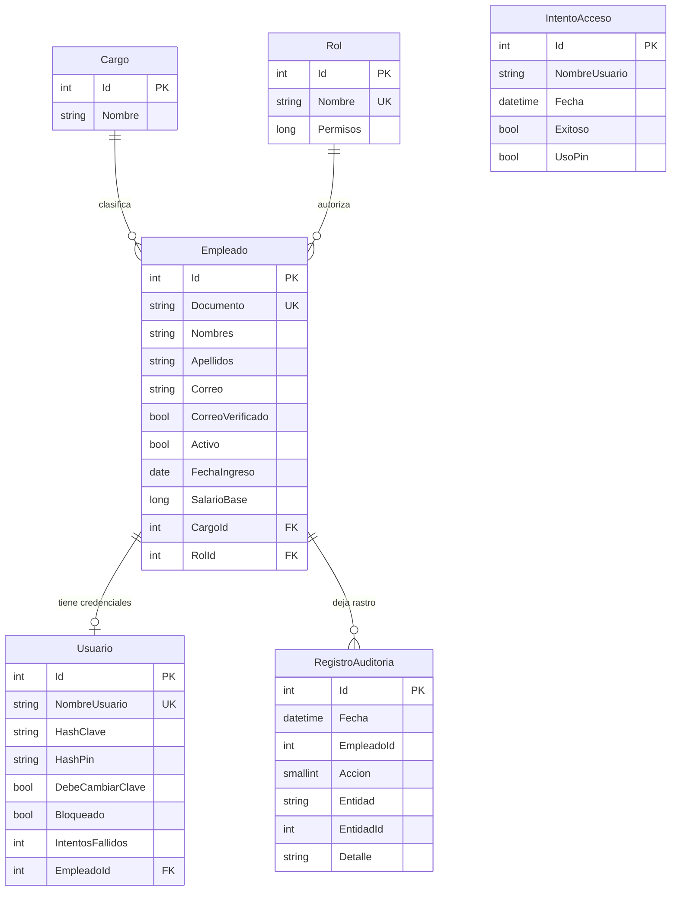
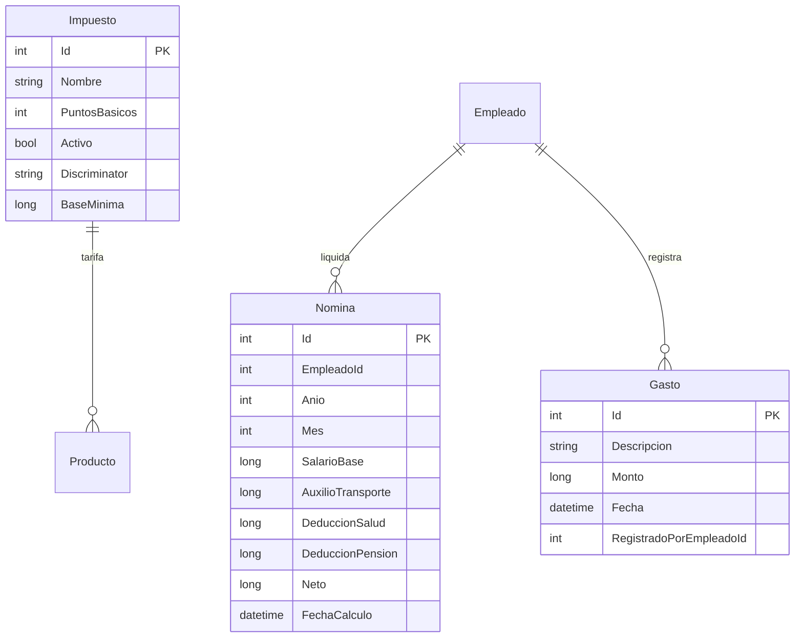
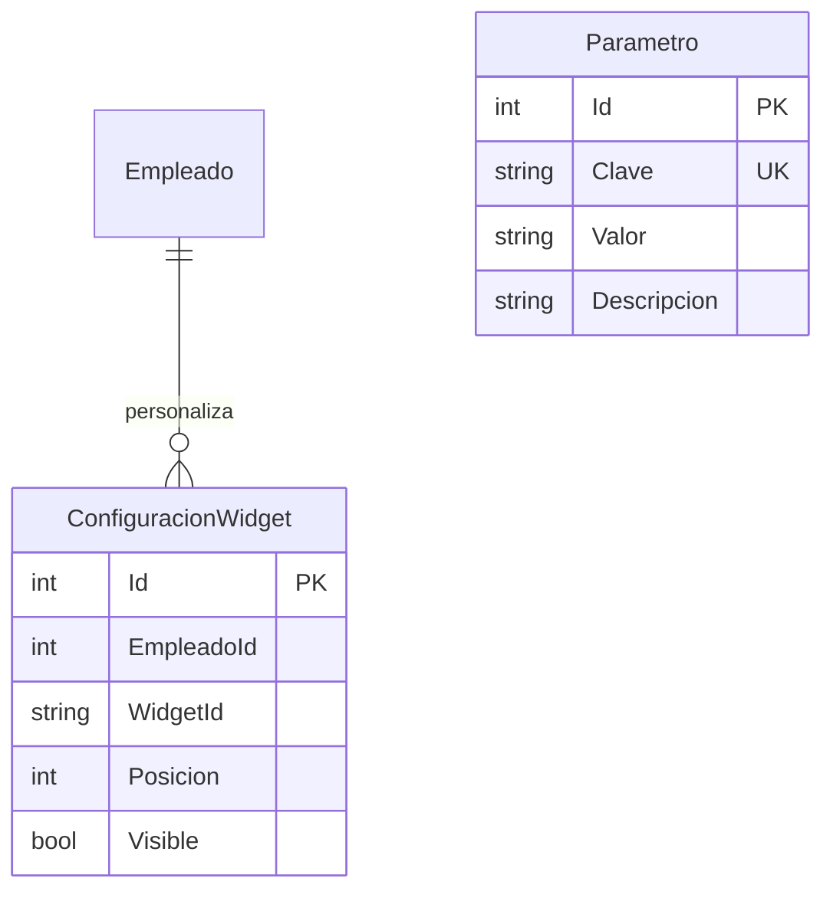

# Modelo entidad-relación

Los diagramas reflejan el modelo que EF Core crea hoy sobre SQLite. Las relaciones sin línea explícita existen como identificador, pero no como FK configurada; se validan en los servicios (ver brechas al final).

## Productos

`Producto` es TPH: `ProductoUnitario` y `ProductoPesado` comparten la tabla `Productos` con `Discriminator`. El índice único es `(ProductoId, NumeroLote)` en `Lotes`.

## Inventario

`StockEstante` y `StockBodega` son tablas independientes con el mismo contrato (`StockLote`). Cada lote aparece como máximo una vez por ubicación.

## Ventas y caja

`Pago` es TPH: `PagoEfectivo`, `PagoTarjeta` y `PagoTransferencia` comparten la tabla `Pago`. `DetalleVenta` congela precio, subtotal y puntos básicos de IVA al momento de la venta.

## Personal y seguridad

`IntentoAcceso` no tiene FK: guarda el nombre usado, exista o no el usuario, para no perder evidencia de intentos contra cuentas inexistentes.

## Finanzas

`Impuesto` es TPH: `Iva` y `Retencion`. `BaseMinima` solo aplica a retención; en IVA queda en 0.

## Dashboards y configuración

`(EmpleadoId, WidgetId)` es único. `Parametro` es una tabla clave-valor sin FK; su significado vive en `ClavesParametro`.

## Correspondencia entidad → tabla

| Entidad | Tabla | TPH |
| :-- | :-- | :-- |
| `Producto` / `ProductoUnitario` / `ProductoPesado` | `Productos` | Sí |
| `Impuesto` / `Iva` / `Retencion` | `Impuestos` | Sí |
| `Pago` / `PagoEfectivo` / `PagoTarjeta` / `PagoTransferencia` | `Pago` | Sí |
| `StockEstante` / `StockBodega` | Tablas propias | No |
| Resto de entidades | Nombre del DbSet | No |

## Brechas del modelo

1. **Sin FK en identificadores sueltos:** `ProductoId` en `StockEstante`, `StockBodega`, `MovimientoInventario`, `Merma` y `Reabastecimiento`; `EmpleadoId` en `Gasto`, `RegistroAuditoria`, `Nomina`, `IntentoAcceso` y `ConfiguracionWidget`. Se validan en servicios.
2. **Sin token de concurrencia:** no hay `xmin` ni `RowVersion` en stock, venta ni turno.
3. **Sin índice parcial de turno abierto:** la regla “una caja, un turno abierto” se valida en `ServicioCaja`, no en la base.
4. **`Venta.TurnoCajaId` sin navegación:** se guarda el identificador, pero no hay FK configurada.
5. **SQLite no impone longitudes ni tipos.** El esquema objetivo de PostgreSQL está en [`diccionario-datos.md`](diccionario-datos.md).

Estas brechas son deuda técnica documentada; las tres primeras se abordan en la migración a PostgreSQL descrita en [`arquitectura.md`](arquitectura.md#concurrencia-multi-terminal-deuda-técnica).
